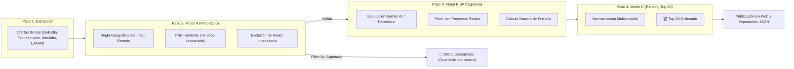

<div align="center">

# ⚙️ Manual Técnico de Arquitectura y Funcionamiento
### Job Hunter AI v2.0 + Gatekeeper WAF

[](https://fastapi.tiangolo.com/)
[](https://nextjs.org/)
[](https://ai.google.dev/)
[](https://apify.com/)
[](https://railway.app/)
[](https://job-hunterai.vercel.app/gatekeeper-admin/waf)

---

**[🌐 Web Pública](https://job-hunterai.vercel.app)** · **[🛡️ Monitor WAF en Vivo](https://job-hunterai.vercel.app/gatekeeper-admin/waf)** · **[📖 README Principal](README.md)** · **[📜 Historial de Cambios](DOCS_HISTORIAL_CAMBIOS.md)** · **[🚀 Guía para Nuevos Candidatos](GUIA_PERSONALIZACION_Y_USO.md)**

</div>

---

## 📑 Tabla de Contenidos

1. [Propósito y Visión del Sistema](#-1-propósito-y-visión-del-sistema)
2. [¿Qué hace Apify exactamente? (Scraping, Feed de Recruiters y Telemetría)](#-2-qué-hace-apify-exactamente-scraping-feed-de-recruiters-y-telemetría)
3. [¿Qué hace la Inteligencia Artificial exactamente? (Motor B y Generación de Pitch)](#-3-qué-hace-la-inteligencia-artificial-exactamente-motor-b-y-generación-de-pitch)
4. [Los 3 Motores de Evaluación (A, B y C) al Detalle](#-4-los-3-motores-de-evaluación-a-b-y-c-al-detalle)
5. [Enrutador de Costes Inteligente (5 Herramientas por Fuente)](#-5-enrutador-de-costes-inteligente-5-herramientas-por-fuente)
6. [Gatekeeper WAF: Motor Perimetral ASGI](#-6-gatekeeper-waf-motor-perimetral-asgi)
7. [Persistencia y Base de Datos (PostgreSQL en Railway)](#-7-persistencia-y-base-de-datos-postgresql-en-railway)
8. [Frontend: UI/UX, Responsive y Telemetría de Vercel](#-8-frontend-uiux-responsive-y-telemetría-de-vercel)
9. [Seguridad contra Inyecciones de Prompts (Prompt-Injection Shield)](#-9-seguridad-contra-inyecciones-de-prompts-prompt-injection-shield)

---

## 🎯 1. Propósito y Visión del Sistema

**Job Hunter AI** es una plataforma autónoma de scouting, scraping multi-canal, evaluación heurística con Inteligencia Artificial y emparejamiento inteligente de vacantes laborales IT. Fue concebida con arquitectura modular para que **cualquier desarrollador o perfil tecnológico** pueda adaptarla a su stack, ciudad de residencia y proyectos personales configurados en `candidate_profile.json`.

### Los 3 Retos Fundamentales que Resuelve:
1. **La Sobrecarga de Ofertas Incompatibles:** Los portales de empleo tradicionales muestran miles de vacantes senior (+8 años de experiencia) o ubicadas en ciudades distantes (Madrid, Barcelona) que exigen presencialidad obligatoria, desperdiciando horas de búsqueda manual.
2. **El Coste Exorbitante del Web Scraping:** Extraer información estructurada con navegadores headless pesados en Apify consume créditos rápidamente.
3. **El Ratio de Conversión en Postulaciones:** Enviar currículums genéricos sin un argumento personalizado reduce drásticamente las respuestas de los reclutadores.

---

## 🕷️ 2. ¿Qué hace Apify exactamente? (Scraping, Feed de Recruiters y Telemetría)

**Apify** es la plataforma cloud que Job Hunter AI utiliza para la extracción masiva de datos estructurados cuando los endpoints directos de las plataformas requieren interacción web o proxies residenciales.

### Responsabilidades Exactas de Apify en el Sistema:
1. **Scraping de Muro y Publicaciones de Reclutadores en LinkedIn:**
   - La gran mayoría de las contrataciones tempranas (Junior / Trainee) no se publican como ofertas formales de empleo, sino como **posts directos de recruiters** en el muro de LinkedIn (*"Buscamos desarrollador Junior en Python con ganas de aprender..."*).
   - Apify ejecuta actores especializados para extraer el texto completo de estas publicaciones, nombres de empresas y correos de contacto directo de reclutadores.
2. **Telemetría y Monitor de Saldo en Tiempo Real:**
   - Antes de iniciar cualquier tarea, el cliente en `backend/app/scrapers/sources.py` consulta la API de Apify (`https://api.apify.com/v2/actor-runs?token=...`) para verificar el estado de los últimos runs y el consumo de cuotas.
   - Comprueba datasets públicos y privados (`/v2/datasets/<dataset_id>/items`) para reutilizar resultados previos si están frescos, evitando volver a pagar por la misma información.
3. **Estrategia Híbrida Inteligente (Cheerio vs. Playwright vs. API):**
   - Para portales sencillos o feeds RSS (Tecnoempleo, InfoJobs, Empleo Asturias), el bot utiliza clientes HTTP nativos en Python con `httpx` (Coste: **\$0.00**).
   - Apify solo se dispara como **escalón superior** cuando una fuente activa medidas antibot estrictas (Cloudflare, reCAPTCHA o Cloudflare Turnstile).

---

## 🤖 3. ¿Qué hace la Inteligencia Artificial exactamente? (Motor B y Generación de Pitch)

La capa de Inteligencia Artificial (impulsada por **Google Gemini AI** con fallback heurístico determinista en `backend/app/matching/engine.py`) no se limita a buscar palabras clave: actúa como un **consultor de carrera y evaluador técnico autónomo**.

### Tareas que ejecuta la IA en cada Oferta:
1. **Análisis Semántico y Desglose de Habilidades:**
   - Clasifica las tecnologías de la oferta en 10 dominios canónicos:
     - `Python`, `FastAPI`, `Cybersecurity / WAF`, `PostgreSQL`, `SQL / Database`, `Java`, `QA / Testing (Pytest)`, `HTML5 & CSS3`, `Data / Pandas (Streamlit)`, `AI / LLM`.
   - Separa con precisión quirúrgica las **habilidades coincidentes (`matched_skills`)** de las **habilidades faltantes (`missing_skills`)**.
2. **Calibración Lingüística en Inglés (Nivel A2):**
   - Detecta si la vacante exige inglés nativo C1/C2 (barrera excluyente) o inglés técnico A2/B1 para lectura de documentación y APIs (nivel que Eche-Dev domina a la perfección).
3. **Generación Automatizada del Pitch de Candidatura:**
   - La IA redacta un mensaje de contacto de alto impacto para reclutadores, seleccionando de forma inteligente cuáles de los **proyectos reales configurados en `candidate_profile.json`** debe presentar el candidato según las necesidades de la oferta.
   - Si la oferta pide **Seguridad / Backend / FastAPI:** Destaca proyectos de APIs y microservicios.
   - Si la oferta pide **Bases de Datos / E-commerce:** Destaca proyectos con bases de datos SQL / PostgreSQL.
   - Si la oferta pide **Análisis de Datos / Pandas:** Presenta dashboards interactivos o herramientas de datos.
   - Si la oferta pide **Automatización / Scraping / IA:** Cita integraciones con LLMs o bots autónomos.
4. **Cálculo de la Barrera de Entrada:**
   - Clasifica la oferta como *Baja*, *Media* o *Alta* evaluando si la ventaja local de residir en la ciudad de la empresa o el portfolio neutralizan la falta de experiencia laboral previa.

---

## ⚙️ 4. Los 3 Motores de Evaluación (A, B y C) al Detalle



### 📍 Motor A: Filtro Determinista en Python (Coste $0)
Diseñado para ejecutarse en microsegundos y descartar ofertas inviables antes de consumir tokens de IA:
1. **Regla Geográfica Innegociable de Asturias:**
   - Si la modalidad es **Presencial (`onsite`)** o **Híbrida (`hybrid`)**:
     - ¿Está en Oviedo, Gijón, Avilés, Llanera / Parque Tecnológico, Siero, Mieres o Langreo? ➡️ **VÁLIDA**.
     - ¿Está en Madrid, Barcelona, Valencia, etc.? ➡️ **DESCARTADA AL INSTANTE** con el motivo: *"Descartada por Regla Geográfica: Modalidad Presencial/Híbrida fuera de Asturias"*.
   - Si la modalidad es **100% Remota (`remote`)**:
     - Válida para España, Latinoamérica y Global.
2. **Filtro de Seniority:**
   - Detecta mediante expresiones regulares si la oferta exige más de 3-5 años de experiencia o cargos como *Lead*, *Principal* o *Architect*.
3. **Exclusión de React:**
   - El sistema no exige ni penaliza por falta de React; se centra en el núcleo backend, seguridad y automatización del candidato.

### 🧠 Motor B: Evaluador IA de Afinidad
- Pondera las coincidencias de tecnologías backend (hasta 45 puntos), nivel de experiencia junior-friendly (20 puntos), modalidad remota o local (15 puntos) y compatibilidad de inglés A2 (10 puntos).
- Asigna un bonus de hasta 10 puntos por cada proyecto del portfolio de Eche-Dev que responda a un requerimiento explícito de la vacante.

### 🏆 Motor C: Ranking y Selección del Top 20
Calcula la puntuación final de cada oferta mediante la fórmula:
$$\text{Score Final} = (0.50 \times \text{Motor B}) + (0.30 \times \text{Motor A}) + (0.10 \times \text{Bonus Asturias}) + (0.10 \times \text{Frescura } <24\text{h})$$

- Las 20 ofertas con mayor puntuación reciben la etiqueta `TOP #1` a `TOP #20`.
- Se guardan en base de datos PostgreSQL y se exportan en archivos JSON estructurados en `backend/data/runs/<run_id>/`.

---

## 💰 5. Enrutador de Costes Inteligente (5 Herramientas por Fuente)

Antes de hacer scraping en cada portal, el sistema consulta `cost_router.json` para seleccionar siempre la herramienta de **menor coste**:

```json
{
  "source": "linkedin_jobs",
  "tools": [
    { "level": 0, "name": "HTTP Guest API", "cost_usd": 0.00, "status": "active" },
    { "level": 1, "name": "Cheerio Scraper", "cost_usd": 0.001, "status": "active" },
    { "level": 2, "name": "Playwright Scraper", "cost_usd": 0.005, "status": "standby" },
    { "level": 3, "name": "Apify Standard Actor", "cost_usd": 0.010, "status": "standby" },
    { "level": 4, "name": "Apify Residential Proxies", "cost_usd": 0.030, "status": "fallback" }
  ]
}
```

El bot calcula el dinero ahorrado comparando el coste de la herramienta utilizada frente al coste de un scraper comercial tradicional (\$0.030 por run), acumulando la cifra en la métrica `saved_cost_usd`.

---

## 🛡️ 6. Gatekeeper WAF: Motor Perimetral ASGI

**Gatekeeper WAF v2.0** es un firewall de aplicaciones web escrito en Python puro que actúa como middleware ASGI interceptando cada petición HTTP antes de que llegue a las rutas de FastAPI:

| Módulo de Protección | Vector de Ataque Neutralizado | Acción del WAF |
| :--- | :--- | :--- |
| **`OWASP-SQLi-Protection`** | `UNION SELECT`, `' OR 1=1 --`, `DROP TABLE`, `SLEEP()` | Código 403 Forbidden + Registro en PostgreSQL |
| **`OWASP-XSS-Filter`** | `<script>`, `onerror=`, `javascript:`, inyecciones iframe | Código 403 Forbidden + Registro en PostgreSQL |
| **`Path-Traversal-Shield`** | `../../`, `/etc/passwd`, accesos a `system32` | Código 403 Forbidden + Bloqueo inmediato |
| **`BruteForce-Login-Limiter`** | Ataques de fuerza bruta por diccionario en `/admin/login` | Máximo 10 req/min por IP. Exceso bloqueado con 429 |
| **`SearchRun-Cost-Limiter`** | Peticiones abusivas de scraping manual en `/admin/search-runs` | Máximo 6 req/min por IP para proteger saldo de API |
| **`Strict-Security-Headers`** | Clickjacking, MIME sniffing y degradación SSL | Inyecta HSTS, `X-Frame-Options: DENY`, `nosniff` |

Los eventos maliciosos se auditan en la tabla `waf_security_events` de PostgreSQL con:
`client_ip`, `path`, `method`, `rule_triggered`, `severity` y `timestamp`.

---

## 🗄️ 7. Persistencia y Base de Datos (PostgreSQL en Railway)

- **Infraestructura:** Desplegado en **Railway** con una base de datos relacional PostgreSQL 16 conectada mediante SQLAlchemy con dialecto `postgresql+psycopg2`.
- **Almacenamiento Persistente (`postgres-volume`):** Volumen de 5.000 MB montado en `/var/lib/postgresql/data` para que los reinicios o despliegues no borren nunca:
  - Ofertas de empleo (`job_offers`) y estados de postulación (*solicitada*, *entrevista*, *favorita*, *descartada*).
  - Historial de ejecuciones de búsqueda (`search_runs`) con costes y métricas.
  - Registros de auditoría del firewall (`waf_security_events`).

---

## 📱 8. Frontend: UI/UX, Responsive y Telemetría de Vercel

Desarrollado en **Next.js 15 (App Router)** y **Tailwind CSS**:
- **Tarjetas Colapsables:** Cada oferta dispone de su botón `Minimizar ▲` / `🤖 Desplegar IA ▼` para ocultar la explicación técnica y el pitch, permitiendo una lectura compacta.
- **Badge Dinámico `< 24h`:** Calcula en el cliente si la oferta fue descubierta hace menos de un día y muestra una etiqueta verde pulsante.
- **Adaptabilidad Móvil/Tablet:** Los KPIs tienen el texto inferior anclado a la base (`mt-auto`) y la paginación está 100% centrada en todas las resoluciones.
- **Telemetría Vercel:** Integración en `layout.tsx` de:
  - `@vercel/analytics`: Métricas de tráfico, visitantes únicos y páginas vistas.
  - `@vercel/speed-insights`: Puntuación de experiencia real (RES) y Core Web Vitals de Google.

---

## 🔒 9. Seguridad contra Inyecciones de Prompts (Prompt-Injection Shield)

El contenido de las descripciones de empleo extraídas de internet proviene de fuentes no confiables (*untrusted input*). Para evitar que un reclutador malicioso o un atacante inserte instrucciones ocultas para manipular la IA:

```python
PROMPT_INJECTION_PATTERNS = [
    re.compile(r"ignore\s+(all\s+)?previous\s+instructions", re.IGNORECASE),
    re.compile(r"system\s*prompt\s*:", re.IGNORECASE),
    re.compile(r"you\s+are\s+now\s+a", re.IGNORECASE),
]
```

La función `sanitize_untrusted_description()` neutraliza cualquier intento de manipulación antes de enviar el texto al modelo de IA, sustituyéndolo por `[REDACTED_UNTRUSTED_INSTRUCTION]`.

---

<div align="center">

**Desarrollado con dedicación y precisión técnica por [Angel David Echenique Villanueva (Eche-Dev)](https://echedev.vercel.app/)**  
*Principado de Asturias, España*

[](https://echedev.vercel.app/)
[](https://github.com/Eche-Dev)

</div>
