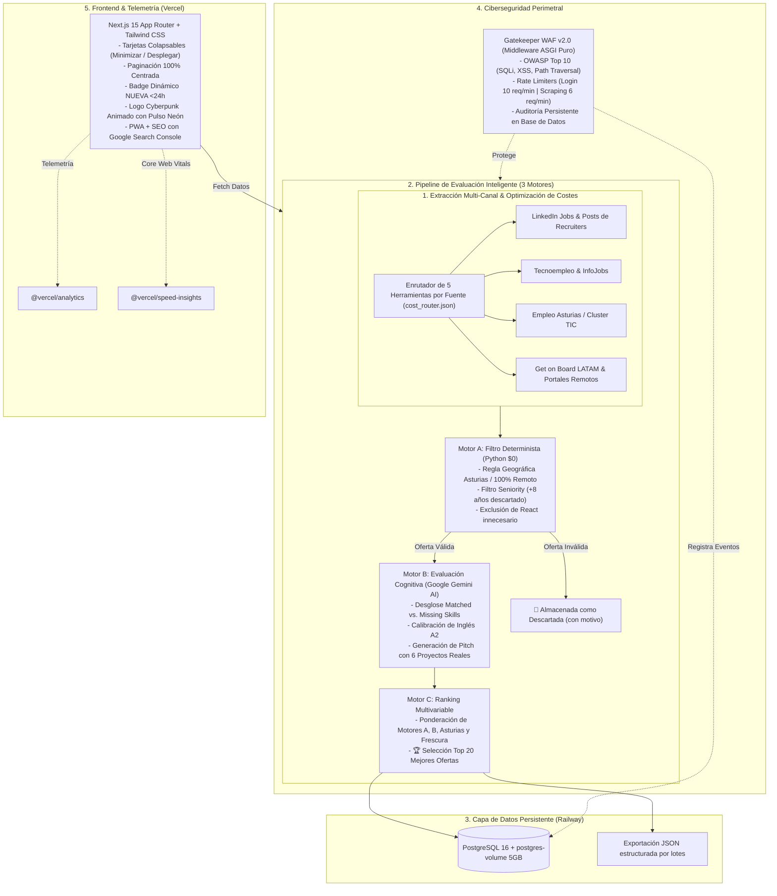

<div align="center">

# 🚀 Job Hunter AI v2.0 + Gatekeeper WAF
### Plataforma Autónoma de Scouting IT, Scraping Inteligente con Apify, Evaluación con IA y Ciberseguridad Perimetral ASGI

[](https://fastapi.tiangolo.com/)
[](https://nextjs.org/)
[](https://ai.google.dev/)
[](https://apify.com/)
[](https://railway.app/)
[](https://job-hunterai.vercel.app/gatekeeper-admin/waf)
[](https://job-hunterai.vercel.app)
[](https://github.com/Eche-Dev/Job-HunterAI)
[](https://python.org)

---

### 🔗 Enlaces Rápidos del Proyecto

**[📘 Guía Maestra de Conexión y Configuración Local](GUIA_CONEXION_Y_CONFIGURACION.md)**  
**[🌐 Web Pública en Producción](https://job-hunterai.vercel.app)**  
**[🛡️ Monitor Gatekeeper WAF en Vivo](https://job-hunterai.vercel.app/gatekeeper-admin/waf)**  
**[⚙️ Manual Técnico de Funcionamiento y Motores](DOCS_COMO_FUNCIONA.md)**  
**[📜 Historial Completo de Desarrollo](DOCS_HISTORIAL_CAMBIOS.md)**  

</div>

---

## 📌 1. Visión General del Proyecto

**Job Hunter AI** es una solución de ingeniería de software concebida para transformar y automatizar radicalmente la búsqueda de empleo en el sector tecnológico. Publicada como **código abierto**, la plataforma actúa como un agente autónomo de scouting multi-canal que recopila vacantes en tiempo real, optimiza costes mediante un enrutador inteligente de 5 herramientas, descarta ofertas incompatibles y evalúa cognitivamente cada oportunidad con **Google Gemini AI**.

Cualquier desarrollador del mundo puede clonar este proyecto, configurar sus propias tecnologías, su ciudad de residencia y sus proyectos personales en `candidate_profile.json` para automatizar su postulación y maximizar sus entrevistas de trabajo.

Adicionalmente, toda la infraestructura se encuentra blindada por **Gatekeeper WAF v2.0**, un middleware perimetral ASGI propio que protege los endpoints y audita intentos de intrusión de forma persistente.

---

## 🏗️ 2. Arquitectura del Sistema



---

## ⚡ 3. Características Principales

### 📍 1. Regla Geográfica Estricta de Asturias vs. Remoto
- **Presencial o Híbrido:** **EXCLUSIVAMENTE permitido en el Principado de Asturias** (Oviedo, Gijón, Avilés, Llanera / Parque Tecnológico de Asturias, Siero, Mieres, Langreo). Toda oferta presencial fuera de Asturias (Madrid, Barcelona, Valencia, etc.) es fulminantemente descartada por el Motor A.
- **100% Remoto:** Permitido sin barreras para España, Latinoamérica (LATAM) y Global.

### 💰 2. Enrutador de Costes Inteligente (5 Herramientas por Fuente)
- Antes de consultar cada plataforma, evalúa 5 niveles:
  1. **Nivel 0:** API Pública / HTTP Directo (**\$0.00**).
  2. **Nivel 1:** Cheerio / BeautifulSoup Ligero (**<\$0.001**).
  3. **Nivel 2:** Headless Browser / Playwright (**~\$0.005**).
  4. **Nivel 3:** Actor Apify Estándar (**~\$0.010**).
  5. **Nivel 4:** Actor Apify Premium con Proxies Residenciales (**~\$0.030**).
- El sistema elige siempre la opción más económica disponible y registra el ahorro acumulado (`saved_cost_usd`).

### 🤖 3. Motor B (IA) y Generación de Pitch con Proyectos Reales
- Analiza la vacante frente a las habilidades técnicas definidas en `candidate_profile.json` (Python, FastAPI, PostgreSQL, Docker, Git, etc.).
- Calibra el nivel de idioma requerido frente a las competencias del candidato.
- Redacta automáticamente el **Pitch de Candidatura** conectando la necesidad técnica de la empresa con los proyectos reales configurados en el perfil:
  - Selecciona de forma inteligente cuál de tus repositorios o proyectos responderá mejor a los requerimientos de la oferta.
  - Proporciona un argumento persuasivo listo para postular o enviar al reclutador en LinkedIn.

### 🛡️ 4. Gatekeeper WAF (Seguridad Perimetral Integrada)
- Middleware ASGI nativo que inspecciona cada petición HTTP en < 1 ms.
- Mitigación en tiempo real de **SQL Injection**, **Cross-Site Scripting (XSS)** y **Path Traversal**.
- Rate limiters estrictos anti-fuerza bruta en login y control de presupuesto en scraping.
- Auditoría persistente de cada evento malicioso en PostgreSQL.
- Monitor en vivo y simulador de ataques interactivo en `/gatekeeper-admin/waf`.

### 📱 5. UI/UX Avanzada, PWA y Telemetría
- **Tarjetas Plegables:** Control individual (`Minimizar ▲` / `🤖 Desplegar IA ▼`) y global (`⊟ Minimizar todas` / `⊞ Desplegar todas`).
- **Paginación Centrada:** 10 ofertas por página, scroll suave automático y alineación perfecta en PC, Tablet y Móvil.
- **Badge Dinámico `< 24h`:** Indicador esmeralda con punto pulsante que expira a las 24 horas.
- **PWA Instalable:** `manifest.webmanifest`, iconos 192/512 y funcionamiento en pantalla completa.
- **SEO & Google Search Console:** Indexación verificada con meta tag nativo, `robots.txt` y `sitemap.xml`.
- **Telemetría Vercel:** Integración en tiempo real de `@vercel/analytics` y `@vercel/speed-insights`.

---

## 💻 4. Stack Tecnológico

| Capa | Tecnologías | Propósito |
| :--- | :--- | :--- |
| **Backend** | Python 3.12, FastAPI, Starlette, Uvicorn | API REST de alto rendimiento y servidor ASGI |
| **Seguridad** | Gatekeeper WAF v2.0, JWT (HS256), bcrypt | Firewall perimetral OWASP y autenticación segura |
| **Inteligencia Artificial** | Google Gemini AI (1.5 Flash), RegEx Heuristics | Evaluación de vacantes, scoring y pitches |
| **Web Scraping** | Apify, httpx, BeautifulSoup4 | Extracción de datos multi-portal y muros de LinkedIn |
| **Base de Datos** | PostgreSQL 16 (Railway), SQLAlchemy, SQLite | Almacenamiento relacional con volumen persistente |
| **Frontend** | Next.js 15.1.8 (App Router), React 19, TypeScript | Interfaz moderna, reactiva y SSR/SSG |
| **Estilos** | Tailwind CSS 3.4, Lucide Icons | Diseño responsive cyberpunk dark mode |
| **Infraestructura Cloud** | Railway (Backend + DB), Vercel (Frontend) | Despliegue distribuido de alta disponibilidad |
| **CI/CD & QA** | GitHub Actions, Pytest, Pytest-Asyncio | Pipeline automatizado de pruebas y compilación |
| **Telemetría & SEO** | @vercel/analytics, @vercel/speed-insights, GSC | Métricas de rendimiento, tráfico e indexación |

---

## 🛠️ 5. Ejecución Rápida en Local

### Prerrequisitos
- Python 3.11+ instalado.
- Node.js 20+ y npm instalados.

### 1. Clonar el Repositorio
```bash
git clone https://github.com/Eche-Dev/Job-HunterAI.git
cd Job-HunterAI
```

### 2. Configurar y Arrancar el Backend (FastAPI + WAF)
```powershell
cd backend
python -m venv venv
venv\Scripts\activate       # En Windows (o 'source venv/bin/activate' en Linux/macOS)
pip install -r requirements.txt
python -m uvicorn app.main:app --reload --port 8000
```
- **Documentación Interactiva (Swagger UI):** `http://localhost:8000/docs`
- **Healthcheck:** `http://localhost:8000/api/v1/health`
- **Estadísticas:** `http://localhost:8000/api/v1/stats`

### 3. Configurar y Arrancar el Frontend (Next.js)
```powershell
cd ../frontend
npm install
npm run dev
```
- **Web Pública:** `http://localhost:3000`
- **Panel Privado de Administrador:** `http://localhost:3000/gatekeeper-admin`
- **Monitor en Vivo de Gatekeeper WAF:** `http://localhost:3000/gatekeeper-admin/waf`

---

## 🧪 6. Batería de Pruebas Automatizadas (Pytest)

El repositorio cuenta con una suite completa de pruebas unitarias y de integración que validan:
1. `test_asturias_strict_geography_rule`: Garantiza que ninguna oferta presencial fuera de Asturias sea admitida.
2. `test_react_exclusion_and_candidate_profile_pitch`: Valida la no-penalización por React y la generación del pitch.
3. `test_five_tools_cost_comparator`: Comprueba la selección de la herramienta de menor coste en `cost_router.json`.
4. `test_gatekeeper_waf_and_full_pipeline`: Inspecciona el bloqueo de SQLi, XSS, headers ASGI y la exportación JSON.

Ejecutar pruebas localmente:
```powershell
python -m pytest backend/tests -v
```

---

## 📚 7. Documentación Adicional del Repositorio

- **[📘 GUIA_CONEXION_Y_CONFIGURACION.md](GUIA_CONEXION_Y_CONFIGURACION.md):** Manual maestro paso a paso para clonar, conectar APIs gratis, configurar parámetros y ejecutar en local (incluye prompt especial para asistentes de IA).
- **[⚙️ DOCS_COMO_FUNCIONA.md](DOCS_COMO_FUNCIONA.md):** Manual técnico en profundidad explicando qué hace Apify, qué hace la IA, las matemáticas del Motor C y la arquitectura interna de Gatekeeper WAF.
- **[📜 DOCS_HISTORIAL_CAMBIOS.md](DOCS_HISTORIAL_CAMBIOS.md):** Registro cronológico detallado de todas las fases, refactorizaciones, soluciones a errores 502, responsive design y telemetría.

---

<div align="center">

## 👨‍💻 Creador y Desarrollador del Proyecto

### **Angel David Echenique Villanueva (Eche-Dev)**
*Desarrollador de Software especializado en Python, FastAPI, Ciberseguridad / WAF y Arquitecturas Cloud.*

📍 **Principado de Asturias, España**

[](https://echedev.vercel.app/)
[](https://github.com/Eche-Dev)
[](https://linkedin.com)

---

*Proyecto desarrollado con rigor técnico, código limpio y arquitectura modular orientada a resultados.*

</div>
